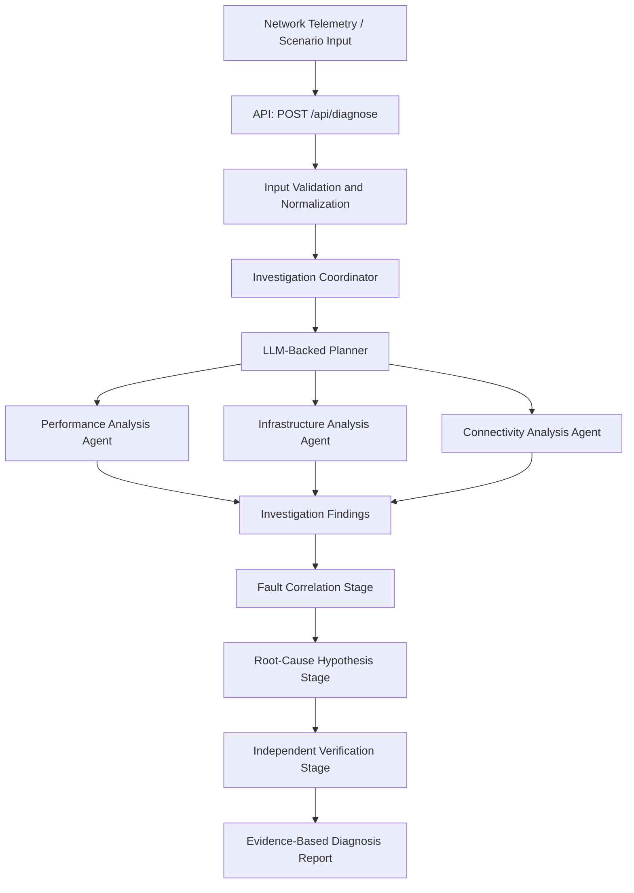

NetCoop AI
Autonomous Multi-Agent Network Fault Investigation & Diagnosis
NetCoop AI is an agentic AI system that investigates network problems by coordinating specialized diagnostic agents, analyzing telemetry, comparing possible root causes, and independently verifying the evidence before producing a structured diagnosis.

Instead of relying on a single response from an AI model, NetCoop AI follows a staged investigation process: it selects relevant diagnostic work, collects findings, correlates evidence, evaluates competing hypotheses, checks those hypotheses against the available evidence, and reports what is known, what remains uncertain, and what should be investigated next.

Live Demo: https://ai-netcoop.vercel.app/
Source Code: https://github.com/Prathamesh-A-Noroliya/Agentic-Ai
The Problem
Network issues can be difficult to diagnose because symptoms often appear across different metrics and systems. High latency, packet loss, interface errors, resource pressure, and congestion may overlap, making it difficult to determine the most likely cause from a single signal.

Traditional troubleshooting can require engineers to inspect multiple metrics, connect findings manually, compare possible explanations, and verify whether the evidence actually supports a conclusion. This takes time and can lead to premature conclusions when evidence is incomplete.
Our Solution
NetCoop AI uses a coordinated, multi-agent investigation workflow to help analyze network telemetry and identify plausible causes of network faults.

The system is designed to:
- Select relevant diagnostic agents based on the current investigation state.
- Analyze performance, infrastructure, and connectivity indicators.
- Correlate findings from different diagnostic stages without assuming that correlation proves causation.
- Generate competing root-cause hypotheses.
- Independently challenge hypotheses against supporting, contradicting, and missing evidence.
- Produce a structured report with findings, confidence, alternatives, limitations, and recommendations.
The system supports investigation and decision-making; its output is not a guarantee that a root cause has been conclusively established.
System Architecture

The coordinator manages the investigation within a single API request. The planner chooses which registered diagnostic agent should run next, using the telemetry, previous findings, missing evidence, completed or failed agents, and the current investigation step.

The system has six registered specialist agents. Three have executable diagnostic adapters; correlation, hypothesis generation, and verification are coordinator-managed reasoning stages. The coordinator itself is not counted as one of the six agents. The agents are not six separately deployed microservices.
The Six Specialist Agents
Agent / Stage	Registered ID	Responsibility
Performance Analysis	performance_analysis	Examines performance indicators such as latency, jitter, packet loss, and utilization.
Infrastructure Analysis	infrastructure_analysis	Examines infrastructure and resource-related telemetry for signs of pressure or faults.
Connectivity Analysis	connectivity_analysis	Examines connectivity indicators and signals such as interface errors and drops.
Fault Correlation	cross_agent_correlation	Connects findings across diagnostic stages and highlights relationships that may help explain the incident.
Root-Cause Hypothesis	root_cause_hypothesis	Develops competing root-cause hypotheses, with confidence and supporting, contradicting, and missing evidence.
Hypothesis Verification	hypothesis_verification	Independently challenges hypotheses and assigns a verification verdict based on available evidence.

Important implementation detail: The first three agents have executable diagnostic adapters. The last three are coordinator-managed reasoning stages, rather than three additional independently deployed services.
How an Investigation Works
1. Receive input — The API receives a network diagnosis request.
2. Validate and normalize — Input fields, aliases, units, ranges, and required values are checked before investigation.
3. Plan the next step — An LLM-backed planner selects a registered diagnostic agent based on the current evidence and investigation state.
4. Run diagnostics — The selected diagnostic adapter produces findings from the supplied telemetry.
5. Update the investigation — Findings and task status are recorded so the coordinator can decide what to investigate next.
6. Correlate findings — The system looks for relationships across findings while avoiding the assumption that correlation alone proves causation.
7. Generate hypotheses — The hypothesis stage compares plausible explanations and records evidence for, against, or still missing from each explanation.
8. Verify independently — The verification stage challenges the hypotheses and returns a verdict: supported, challenged, or inconclusive.
9. Produce the report — The system returns a structured diagnosis with its evidence, alternatives, uncertainty, and recommendations.
The planner can direct up to five diagnostic steps. The coordinator then proceeds to correlation, hypothesis generation, verification, and reporting. If the planner returns an invalid agent selection, the system falls back to a registry- and coverage-based choice.
Evidence, Hypotheses, and Decision Rules
NetCoop AI is designed to make its reasoning inspectable rather than returning only a root-cause label.

The report can include:
- Supporting evidence and its sources.
- Findings from diagnostic stages.
- Competing hypotheses and their confidence values.
- Verification verdicts.
- Alternative possible causes.
- Missing evidence and investigation limitations.
- Recommendations for further investigation or response.
Verification verdicts
- supported — Available evidence supports the hypothesis.
- challenged — Available evidence conflicts with or challenges the hypothesis.
- inconclusive — The evidence is insufficient to reach a clear verdict.
Final outcome classification
The application uses a confidence threshold of 0.70 together with the verification verdict to classify the final outcome:
- probable_cause — Exactly one hypothesis qualifies as supported with confidence of at least 0.70.
- multiple_plausible_causes — Two or more hypotheses meet those criteria.
- insufficient_evidence — No hypothesis meets those criteria.
The 0.70 threshold is an application-level decision rule. It should not be interpreted as a statistically calibrated 70% probability that a hypothesis is true.
Agent Communication and Task Management
Agent communication uses a versioned JSON message envelope (v1.0). Messages include:
- protocol_version
- message_id
- correlation_id
- incident_id
- sender
- recipient
- message_type
- timestamp
- payload
Supported message types include finding, hypothesis, verification, request, and response.

The in-memory message bus and dispatcher apply checks such as message validation, duplicate rejection, registered-agent and identity checks, incident matching, capability checks, and evidence-ID checks. Stored messages are cloned to help avoid accidental mutation. Each investigation has a limit of 5,000 stored messages.

Task states follow this lifecycle:

pending → running → completed / failed / timed_out

A task is considered complete only when a correlated response is received from its assigned agent. The message bus is process-local and in-memory for each investigation request; it is not a persistent distributed messaging service.
API Reference
POST /api/diagnose
Submit a network telemetry payload for investigation.

Content type: application/json
Request body limit: 100 KB

The API validates and normalizes the payload before calling runInvestigationCoordinator().
HTTP status	Meaning
200	Investigation completed successfully.
400	Malformed JSON or validation error.
413	Request body is too large.
415	Unsupported content type.
500	Coordinator or agent failure.

Successful responses use a no-store cache header.

The resulting report includes fields such as:
- suspected_root_cause
- confidence
- supporting_evidence
- alternative_causes
- evidence_sources
- findings
- evidence_catalog
- hypotheses
- verifications
- missing_evidence
- limitations
- recommendations
The exact accepted payload structure should be checked against the current API implementation before integrating another client.
Input Validation and Normalization
The input layer accepts supported metric aliases and normalizes them into the expected telemetry fields. Examples of supported aliases include:
- rtt
- packetLoss
- cpu_percent
- if_errors
- output_drops
Supported unit conversions include seconds to milliseconds and bandwidth expressed in Gbps, Kbps, or bps to Mbps. Applicable fractional values are converted to percentages.

The validator rejects unknown aliases, ambiguous duplicate values, unsupported units, non-finite values, and values outside the accepted ranges.
Metric type	Validation rule
Latency and jitter	0–3,600,000 ms
Packet loss, utilization, CPU, and memory	0–100%
Interface errors and drops	Non-negative integers
Bandwidth	Bounded numeric value, with an upper limit of 10^9 Mbps in the validator

Validation prevents malformed or unsupported inputs from being treated as reliable diagnostic evidence.
Test Scenarios
The project includes six JSON test scenarios: five valid scenarios and one invalid-input scenario.
Scenario	Example device / segment	Main signals represented
Normal network	core-switch-01	12 ms latency, 2 ms jitter, 0% packet loss, 28% CPU, 42% memory, 35% utilization
Link congestion	gateway-01	280 ms latency, 8% packet loss, 75 ms jitter, 96% utilization, 420 queue drops
Weak Wi-Fi	hostel-ap-01	180 ms latency, 12% packet loss, 55 ms jitter
Interface fault	department-switch-02	850 interface errors, 6% packet loss, 120 drops
DNS/DHCP segment	campus-dns-dhcp-segment	25 ms latency, 0% packet loss; no DNS/DHCP-specific telemetry supplied
Invalid input	test-device-06	Invalid latency value ("unknown"), unsupported metric, and missing timestamp

These scenarios exercise normal telemetry, common fault patterns, limited evidence, and validation failures. A scenario's label is test context, not proof that the system can always identify that cause from the supplied metrics alone.
Technology Stack
Area	Technologies
Web framework	Next.js 16.4.3
UI	React 19.3.0, TypeScript
AI integration	OpenAI SDK and shared LLM client
Styling	Tailwind CSS
Charts	Recharts
Motion and visualization	Framer Motion, Three.js, React Three Fiber, Drei
Deployment	Vercel

Run Locally
Prerequisites
- Node.js and npm.
- The project repository.
- The environment variables required by the shared LLM client.
1. Clone the repository
git clone https://github.com/Prathamesh-A-Noroliya/Agentic-Ai.git
cd Agentic-Ai
2. Install dependencies
npm install
3. Configure environment variables
Create a .env.local file in the project root and add the variables expected by the shared LLM client. Check the implementation for the exact variable names and required values. Do not commit API keys or other secrets to Git.
4. Start the development server
npm run dev
Open the local URL printed by Next.js in your terminal.
Run Tests
Run the available checks from the project root:
npm run build
npm test
npx tsx test-scenarios.ts
- npm run build — checks whether the application builds successfully.
- npm test — runs test-netcoop.ts.
- npx tsx test-scenarios.ts — runs the scenario test script.
Some investigation paths may require valid LLM environment configuration. Configure the required variables before testing LLM-backed behavior.
Current Scope and Limitations
- The first three specialist agents have executable diagnostic adapters; correlation, hypothesis generation, and verification are coordinator-managed reasoning stages.
- Agent messages are stored in a process-local, in-memory message bus for an investigation request. This is not a durable message queue or a distributed multi-service deployment.
- Diagnosis quality depends on the quality, completeness, and relevance of the input telemetry.
- The system may report multiple plausible causes or insufficient evidence rather than a single definitive cause.
- The 0.70 confidence threshold is a configured decision threshold, not a calibrated probability.
- The supplied DNS/DHCP scenario does not include DNS- or DHCP-specific telemetry, so those causes cannot be conclusively established from that scenario alone.
- Recommendations support analyst investigation; they should be reviewed in context before operational changes are made.
Project Information
Project: NetCoop AI — Autonomous Multi-Agent Network Fault Investigation & Diagnosis
Hackathon: TechZephyr 4.0, IIT Bhubaneswar
Team: HackTech Novas
Team members: Prathamesh Anil Noroliya and Purvesh Ramesh Mali
Explore the live demo: https://ai-netcoop.vercel.app/
View the source code: https://github.com/Prathamesh-A-Noroliya/Agentic-Ai
